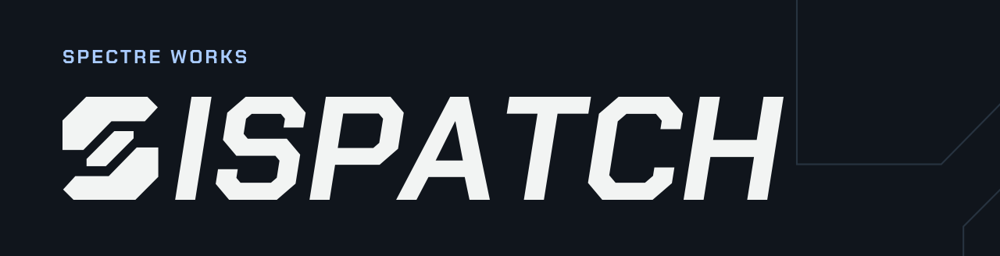

<!-- SPDX-FileCopyrightText: 2026 SPECTRE WORKS LLC -->

# 

DISPATCH is a source-available developer preview.

DISPATCH manages miners on your local network. Set the hours and electricity
budget, pair each miner with a metered outlet, and review what the controller
would do before enabling it. Once enabled, DISPATCH/01 keeps operating when
the browser closes.

## Get to Preview

Start with an AtomS3-Lite, a USB data cable, a trusted 2.4 GHz LAN, and one
compatible metered outlet and miner. Follow the quickstart to build and
flash the firmware, join Wi-Fi, and see what DISPATCH would do in Preview.
[Get to Preview](START-HERE.md#get-to-preview) · [Already set up?](docs/operations.md)

- **Plan mining around power and cost.** Combine allowed mining hours, Quiet
  Hours, paid starts, and daylight gap coverage under one plan. Use solar
  production estimates from an APsystems ECU-R or measured grid flow from a
  verified site meter.
- **Learn and coordinate equipment.** Run a supervised first-run power test
  for unknown startup draw. Set outlet priority and use measured preset
  comparisons on compatible miners to manage power per miner.
- **See what happened.** Activity shows power readings, relay and preset
  changes, the reason miners ran or waited, and estimated paid energy and cost.

**DISPATCH Preview for StartOS** uses live LAN equipment to preview this
operating plan. Export the plan for DISPATCH/01 when you are ready to use
a controller. [Install Preview on StartOS](docs/startos.md)

[Compatibility](docs/compatibility.md) · [Operating policy](docs/operating-policy.md)

## Work on the repository

Run the repository and portable C checks from the checkout with **Python
3.11+**, a host C compiler, and a POSIX shell. This works without a controller
or ESP-IDF.

```sh
./tools/check.sh
```

| Area | Where to work |
| --- | --- |
| Operating plan decisions, energy accounting, daylight, and learned equipment evidence | [core/](core/README.md) |
| Device and mining-service protocols | [integrations/](integrations/README.md) |
| Embedded worker, provisioning, storage, and local HTTP routes | [apps/controller/](apps/controller/README.md) |
| Dashboard served by the controller | [apps/web/](apps/web/README.md) |
| Synthetic equipment, host tests, and on-device observation | [tests/](tests/README.md) |

[Developer setup and USB flash](docs/development.md) · [Architecture](docs/architecture.md) · [Contributing](CONTRIBUTING.md) · [Agent instructions](AGENTS.md)

## Licensing

DISPATCH is source-available. See [LICENSING.md](LICENSING.md) for the
application terms, documentation license, and third-party notices.
